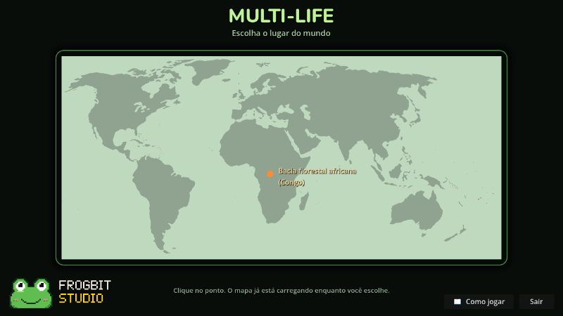
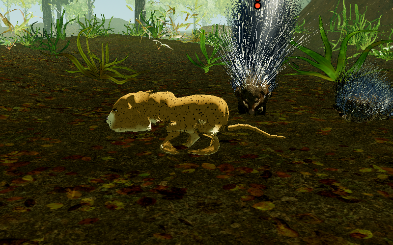
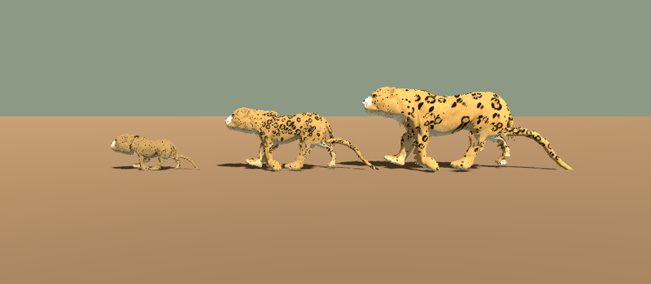
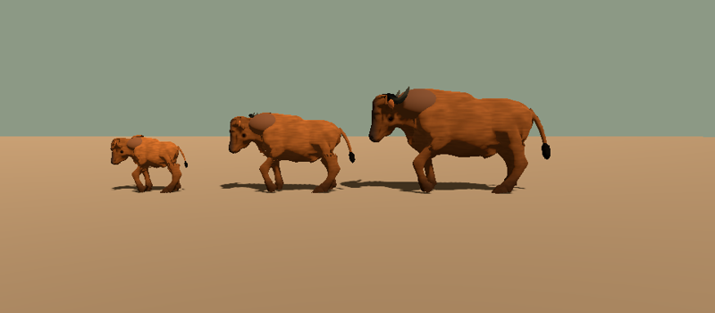
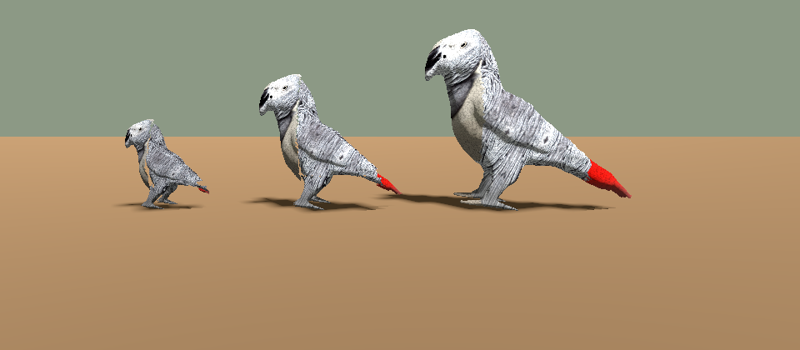

# 🌍 MULTI-LIFE

Viva como um bicho de verdade na floresta africana.
Nasça filhote, coma, beba água, fuja dos predadores, se esconda e cresça até virar adulto.

> **Versão 0.3 (beta).** O jogo ainda está sendo feito. Pode ter bugs!

## O primeiro mapa: Bacia Florestal Africana (Congo)

Uma floresta enorme, com rio, árvores, cupinzeiros e mais de 200 bichos vivendo sozinhos.
Eles caçam, fogem, se assustam, avisam o bando quando tem perigo, dormem e têm filhotes.

### 8 bichos pra jogar

| Bicho | Como é |
|---|---|
| 🦡 Mangusto | Pequeno e rápido. Bom pra começar. |
| 🦔 Porco-espinho | Lento, mas quem te morde se arrepende. |
| 🐆 Leopardo | Caçador solitário. Chega agachado e ataca de surpresa. |
| 🐃 Búfalo | Pesado e forte. A manada se defende junta. |
| 🐘 Elefante | Gigante. Quase nada te ameaça. |
| 🐍 Píton | Espera parada e dá o bote. Sobe em árvore. |
| 🐊 Crocodilo | Dono do rio. Fica escondido na água. |
| 🦜 Papagaio | Voa! Come fruta lá em cima das árvores. |

### Filhote, jovem e adulto

Cada bicho cresce de verdade: o filhote é cabeçudo, de perninha curta (ou pernudo, no caso do búfalo), e vai mudando até virar adulto.

## Como baixar e jogar

1. Vá em **[Releases](../../releases/latest)** e baixe o **Multi-Life-v0.3-beta-Windows.zip**.
2. Clique com o botão direito no zip e escolha **Extrair tudo**. Não abra o jogo de dentro do zip!
3. Abra a pasta e dê dois cliques em **Multi-Life.exe**.
4. Se o Windows mostrar "O Windows protegeu o computador", clique em **Mais informações** e depois em **Executar assim mesmo**. É um jogo feito em casa, não é vírus.

O mapa demora um pouco pra carregar. Enquanto isso, você já escolhe o seu bicho.

## Controles

| Tecla | O que faz |
|---|---|
| W A S D | Andar |
| Shift | Correr |
| Alt | Trotar |
| Espaço | Pular (papagaio: voar) |
| Ctrl | Agachar / mergulhar |
| Mouse esquerdo, direito e do meio | Ataques |
| V | Defender |
| E | Comer / beber / interagir |
| F | Farejar (mostra comida, água e bichos por perto) |
| N | Visão noturna |
| X / Z | Sentar / dormir |
| 1 2 3 4 | Emotes (chamar, amizade, ameaçar...) |
| M | Mapa |
| Tab | Informações do bicho |
| Esc | Pausa |
| F11 | Tela cheia |

## Créditos

Feito por **Gomes** (Frogbit Studio), com Godot.

**Modelos dos bichos:** baseados em esculturas do Thingiverse com licença Creative Commons Atribuição (CC BY 4.0), reformadas para o jogo:
- Leopardo: "Big Cat - Lion - Puma - Panther" ([thing:3992827](https://www.thingiverse.com/thing:3992827)), de Yasahii
- Mangusto: "Ferret" ([thing:3612723](https://www.thingiverse.com/thing:3612723)), de schlossbauer
- Búfalo: "cow" ([thing:3648367](https://www.thingiverse.com/thing:3648367)), de Amforma
- Elefante: "Elephant" ([thing:3532183](https://www.thingiverse.com/thing:3532183)), de Gilzone
- Crocodilo: "Crocodile" ([thing:4601600](https://www.thingiverse.com/thing:4601600)), de outstandy
- Papagaio e turaco: "Parrot Figure" ([thing:4902845](https://www.thingiverse.com/thing:4902845)), de DragonArtist15

**Plantas, pedras e texturas:** [Poly Haven](https://polyhaven.com) (CC0).

**Sons:** Wikimedia Commons (Creative Commons), PLOS ONE 2010 (CC BY), Internet Archive (domínio público) e The Designer's Choice (CC0). Os outros sons e as músicas foram feitos por código.
